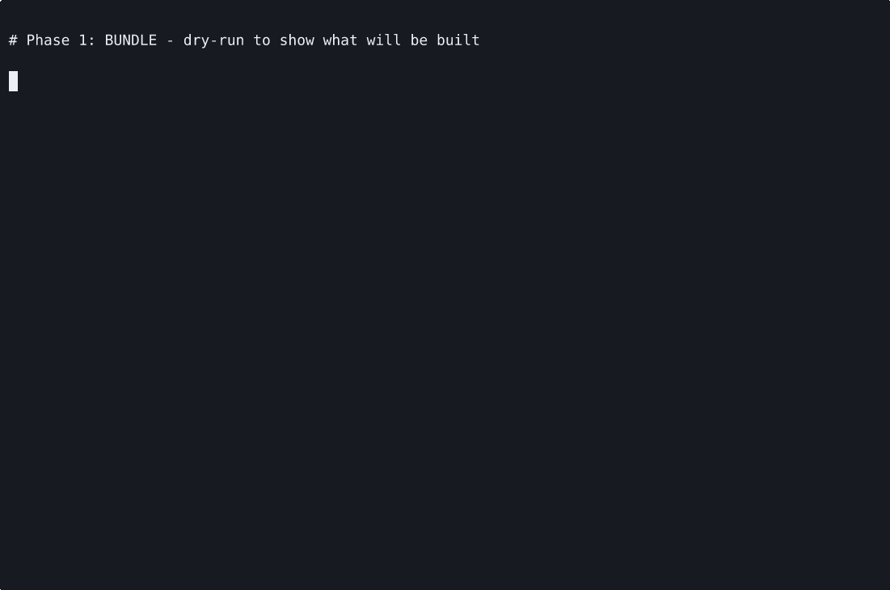
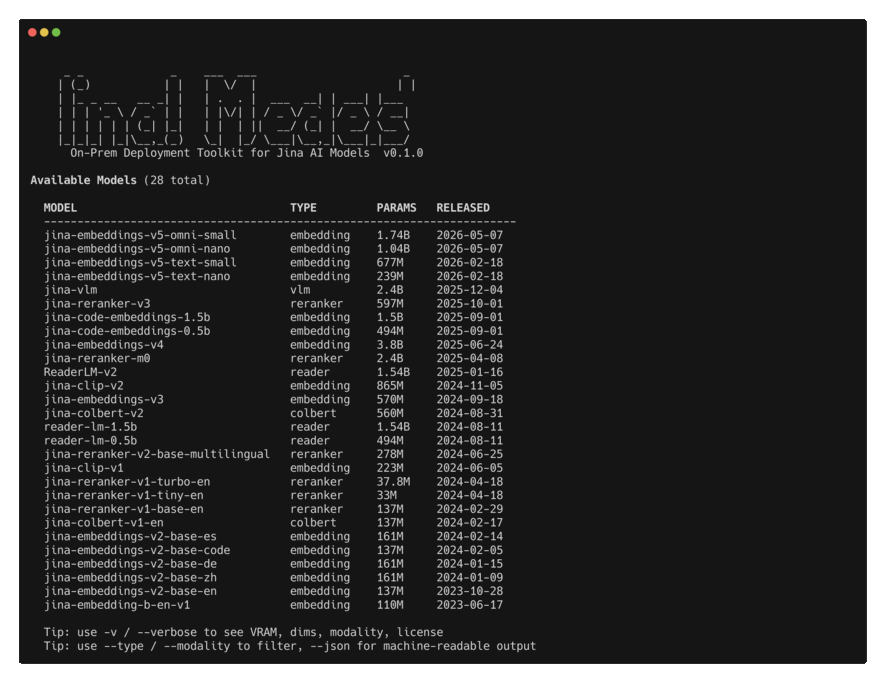

How to build your own bundle from scratch. Use this when:

- The model you want isn't in the [prebuilt list](Model-Catalog)
- You need to pin different dependency versions
- Your policy forbids `docker pull` from third-party registries

Output: a single self-contained `.tar.gz`. Bundle once, transfer, run forever offline.

```
  connected builder   ──►  python jina-on-prem.py bundle  ──►  docker build
  (network + Docker)         (reads catalog.json)            stage 1: pinned deps into a venv
                                                              stage 2: HF download + patch
                                                              stage 3: COPY-only runtime, no RUN:
                                                                       venv + weights + server + OFFLINE=1
                                                                    │
                                                                    ▼
                                                    docker save | gzip ──► MODEL-cpu.tar.gz
                                                                    │
                                                                    │  SCP / USB / approved channel
                                                                    ▼
                                                          air-gapped host (Docker only)
                                                                    │
                                                                    ▼
                                                    docker load < tar.gz
                                                    docker run -p 8080:8080
```

## Prerequisites (connected machine)

| Requirement | Notes |
|---|---|
| Linux x86_64 | Ubuntu 22.04 tested. macOS works via Docker Desktop but slow |
| Docker 24+ with BuildKit | comes with modern Docker |
| Python 3.10+ | CLI is single-file, stdlib only |
| Disk: 100 GB or more | enough for one or two models, including the BuildKit cache; bundling the whole catalog takes several hundred GB |
| Network | bundle phase pulls weights from Hugging Face |
| For GPU bundles | no GPU needed at build time; CUDA comes from the PyTorch wheels |



## Bundle on your own machine

Any Linux box with Docker. No GPU is needed at build time, even for a GPU bundle.

```bash
git clone https://github.com/jina-ai/jina-on-prem.git
cd jina-on-prem
python3 jina-on-prem.py bundle --model jina-embeddings-v5-text-nano --cpu-only --yes
```

## Optional: bundle on a cloud VM

Same output, different builder. Worth it when your own machine is not Linux x86_64 (macOS builds under emulation and is markedly slower), or is short on the 30-200 GB of disk or on bandwidth for the weight download. The repo ships [`scripts/bootstrap-gcp.sh`](https://github.com/jina-ai/jina-on-prem/blob/main/scripts/bootstrap-gcp.sh), a one-shot provisioner for Google Cloud, which creates an instance with Docker, the NVIDIA Container Toolkit and the repo already cloned. It takes the project from your own `gcloud` configuration; nothing about it is specific to a particular account.

Ask for a CPU-only instance. Nothing in a build needs a GPU, and GPU instance types are the ones that run out of capacity:

```bash
GPU_COUNT=0 MACHINE_TYPE=e2-standard-4 ./scripts/bootstrap-gcp.sh   # CPU-only builder
./scripts/bootstrap-gcp.sh                                          # defaults, attaches an L4
./scripts/bootstrap-gcp.sh my-builder us-east4-a                    # different zone
```

The zone is the second positional argument and defaults to `us-central1-a`; it is not read from your `gcloud` configuration.

> GPU instance types are frequently out of capacity in the busiest zones. If the script reports "does not have enough resources", try another zone. See [Troubleshooting -> L4 stockout](Troubleshooting#l4-stockout).

After provisioning, the script prints the SSH command. From inside:

```bash
cd ~/jina-on-prem
sg docker -c 'python3 jina-on-prem.py bundle --model jina-embeddings-v5-text-nano --cpu-only --yes'
```

`sg docker -c '...'` is only needed in the same session that installed Docker. After an SSH reconnect, plain `docker` works.

## CLI commands



```bash
python3 jina-on-prem.py list                              # all models
python3 jina-on-prem.py list --type embedding --verbose   # filter + extras
python3 jina-on-prem.py list --json                       # machine-readable

python3 jina-on-prem.py bundle                            # interactive picker
python3 jina-on-prem.py bundle --model MODEL              # GPU runtime
python3 jina-on-prem.py bundle --model MODEL --cpu-only   # CPU image
python3 jina-on-prem.py bundle --model MODEL --yes        # non-interactive (CI)

python3 jina-on-prem.py deploy --image PATH.tar.gz        # load + run (testing)
python3 jina-on-prem.py serve --model MODEL               # no Docker, requires deps installed
```

Backward-compatible aliases: `pack` -> `bundle`, `load` -> `deploy`.

A gated Hugging Face model needs a token at bundle time. Pass it in the environment:

```bash
HF_TOKEN=hf_... python3 jina-on-prem.py bundle --model MODEL
```

`--hf-token` also exists, but a value given on the command line is visible in the process list for the whole build, so prefer the environment variable. `bundle` hands the token to `docker build` by name only, so it never appears on that command line either.

## Output

A successful bundle produces:

```
jina-embeddings-v5-text-nano-cpu.tar.gz       # for --cpu-only
jina-embeddings-v5-text-small-gpu.tar.gz      # for GPU runtime
```

Sizes: under 2 GB for the nano/small text models on CPU and 4-6 GB on GPU; multimodal models run larger. See [Sizing & Hardware -> Published image sizes](Sizing-And-Hardware#published-image-sizes).

## CPU vs GPU runtime

|  | CPU image | GPU image |
|---|---|---|
| Base image | `cgr.dev/chainguard/wolfi-base` | `cgr.dev/chainguard/wolfi-base`, with CUDA from the PyTorch wheels |
| Image size | weights plus a CPU-only torch | adds a few GB of CUDA runtime on top; see [Sizing & Hardware](Sizing-And-Hardware#published-image-sizes) |
| Runs on host with GPU | yes (ignores GPU) | yes |
| Runs on host without GPU | yes | yes, falls back to CPU |
| Inference speed | ~10x slower | full speed |
| Build wall-clock | ~3-15 min | ~10-30 min |

If unsure, build both. The runtime host decides which to load.

## Base image

A bundle builds on Chainguard's `cgr.dev/chainguard/wolfi-base`, which anyone can pull, and installs Python 3.11 from Wolfi's package repository. The base is pinned by digest in `docker/Dockerfile.cpu` and `docker/Dockerfile.gpu`; Python is not pinned, so a bundle gets the newest 3.11 patch release Wolfi carries on the day it is built. The build machine therefore needs to reach `cgr.dev` and `packages.wolfi.dev`, as well as the Python package indexes, `download.pytorch.org` for the torch wheels, and Hugging Face.

The prebuilt images use the same Dockerfiles on a distroless Wolfi Python base, which needs an Elastic login to pull. `bundle` has no flag for it: selecting it means running `docker build` by hand with `--build-arg BASE=official`. Everything after the base is the same file, so a bundle installs the same Python packages. What differs is the operating system layer: a bundle keeps `wolfi-base`'s shell and `apk`, so an image scanner lists a few more packages in it than in a prebuilt image.

Bundling on this base is supported. At each release, a CPU and a GPU model are built this way and their vectors compared with the prebuilt images.

## Bundle wall-clock examples

Measured on `g2-standard-4` (4 vCPU + 1xL4) in `asia-southeast1-a` (May 2026):

| Model | Runtime | Build time | Output size |
|---|---|---|---|
| jina-embeddings-v5-text-nano | cpu | 3.5 min | 766 MB |
| jina-embeddings-v5-text-small | gpu | 14 min | 4.4 GB |

GPU bundle wall-clock is dominated by downloading the PyTorch CUDA wheels.

## Disk hygiene during multi-model builds

Each bundle accumulates: built image + tarball + BuildKit cache. Reclaim between bundles:

```bash
docker builder prune -af      # reclaim BuildKit cache (always safe)
docker system prune -f        # remove dangling layers
rm jina-OLDMODEL-*.tar.gz     # remove tars you've already transferred
df -h /                       # confirm
```

The same loop bundles several models on one host - each build is independent, so a failure part-way leaves the earlier bundles intact.

## Transfer to the air-gapped machine

The `.tar.gz` is one self-contained file. Move it however your policy allows:

| Channel | Notes |
|---|---|
| SCP | fastest if both ends are on a routable network |
| SFTP / FTPS | if SCP is blocked |
| Object storage (S3, GCS) | if the air-gapped side can reach it |
| USB / removable disk | true air-gap, sneakernet |
| Optical media (DVD, BD-R) | maximum-security data centre |
| Whatever your change-management process approves | regulated environments usually have a fixed channel |

On the target host:

```bash
docker load < jina-MODEL-cpu.tar.gz
docker run -d -p 8080:8080 jina/MODEL:cpu
curl http://localhost:8080/health
```

That's the entire air-gapped deploy. The image has `HF_HUB_OFFLINE=1` and `TRANSFORMERS_OFFLINE=1` baked in - any code path that would call out to Hugging Face fails immediately rather than silently downloading.

## Caveats worth knowing before you build

- Each model's `transformers` version is pinned. See [Troubleshooting -> Transformers version pins](Troubleshooting#transformers-version-pins).
- Reranker models load as `CrossEncoder`, not `SentenceTransformer`. Handled in the server, relevant only if you `serve` directly.
- v5-omni models need ~30 GB free disk during build.
- The bundle deletes each model repo's `requirements.txt` to prevent runtime auto-upgrade. This is intentional.
- A GPU bundle can run for the better part of an hour, so run it under `nohup` or `tmux`. On a preemptible or spot instance it will otherwise die with your session. Docker images survive a reboot; `/tmp` does not, so write build logs somewhere persistent.

## Next

- [Quick Start](Quick-Start) - test the bundle you just built
- [API Reference](API-Reference) - what the server exposes
- [Troubleshooting](Troubleshooting) - build and deploy errors
