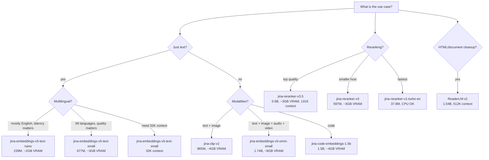
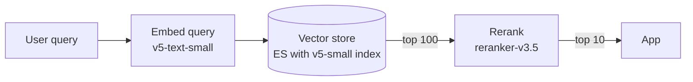

The [Model Catalog](Model-Catalog) lists every model; most deployments use one of the handful in this decision tree.

## Quick reference by use case

| Use case | Model | Why |
|---|---|---|
| First demo / proof of concept | `jina-embeddings-v5-text-nano` | smallest, fastest to bundle, CPU works |
| Production multilingual semantic search | `jina-embeddings-v5-text-small` | 89 languages, task-aware, 32K context |
| Drop-in for OpenAI `text-embedding-3-small` | `jina-embeddings-v5-text-nano` | similar dim (768), credible quality |
| Multimodal RAG (PDFs with images) | `jina-embeddings-v5-omni-small` | image + text in same space; `jina-embeddings-v4` is Legacy |
| Image search | `jina-clip-v2` | optimized for text + image |
| Code search | `jina-code-embeddings-1.5b` or `0.5b` | trained on code |
| Reranking | `jina-reranker-v3.5` | best quality, long context |
| Reranking on a memory-tight host | `jina-reranker-v3` | lighter host-RAM profile on the `:cpu` image - see [Sizing](Sizing-And-Hardware#reranker-host-memory) |
| Cheap fast reranking, English only | `jina-reranker-v1-turbo-en` | 37.8M params, CPU OK |
| HTML to clean markdown | `ReaderLM-v2` | 512K context, document focused |
| Legacy English embeddings | `jina-embeddings-v2-base-en` | Apache-2.0, no commercial license needed |

## Trade-offs

**Bigger isn't always better.** v5-text-small is a stronger model than v5-text-nano, but the nano is 3x smaller and runs on CPU. With a tight latency budget and English-only data, nano often wins.

**License model.** v5 and v3 models are CC-BY-NC-4.0 and v4 is under the Qwen Research License; commercial use of any of them requires a license from Elastic. The Apache-2.0 models, free for any use, are the v2 text embeddings (`jina-embeddings-v2-base-*`), `jina-clip-v1`, `jina-colbert-v1-en` and the v1 embedding and reranker models; the License column of the [Model Catalog](Model-Catalog) is authoritative. To evaluate without a commercial license, or for deployments that require Apache-2.0, use `jina-embeddings-v2-base-en` (or `-zh`, `-de`, `-es`).

**Multimodal models cost more memory.** A v5-omni-small needs ~8GB VRAM. A v5-text-nano needs 2GB. If you are not indexing image, audio or video, do not pay for the capability.

**Matryoshka truncation lets you downsize at query time.** The server accepts any `dimensions` value up to the model's full output and truncates to it; the Output column of the [Model Catalog](Model-Catalog) gives the smallest width each model was trained for (32 on v5 and v3, higher on v4 and some others), and going below it is not rejected, it just degrades quality. Index at 1024-dim and query at 128-dim if you want a smaller index. Pass `dimensions: 128` in the request.

## When to use multiple models

A real production stack often combines:

- Embedding model for indexing and first-pass retrieval
- Reranker for high-precision top-K
- Optional ReaderLM if input is messy HTML/PDF

Both models can run side-by-side in two containers, OR you can deploy two replicas of each behind a load balancer if QPS demands it. See [Sizing & Hardware](Sizing-And-Hardware) for capacity planning.

## Next

- [Sizing & Hardware](Sizing-And-Hardware) - how much GPU/RAM/disk
- [Model Catalog](Model-Catalog) - full specs for all 29
- [Deployment Patterns](Deployment-Patterns) - deployment examples by use case
