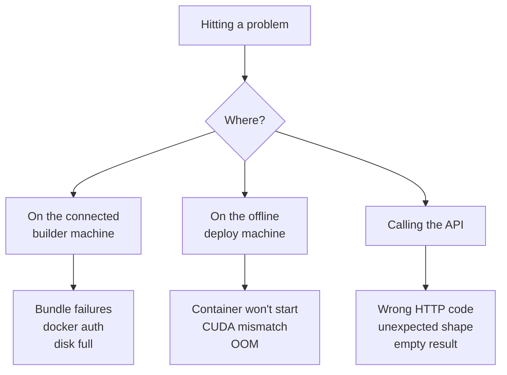

If you hit something not listed here, [Support](Support) covers where to report it and what to include - including what not to put in a public tracker.



Jump to a section: [Docker / install](#docker-permission-denied) - [CUDA mismatch](#cuda-mismatch) - [OOM](#out-of-memory-on-gpu) - [Transformers version pins](#transformers-version-pins) - [GHCR auth](#prebuilt-pull-unauthorized) - [Wrong endpoint](#wrong-endpoint-returns-400) - [License 403](#403-with-type-license_error) - [Verifying the air gap](#verifying-the-air-gap) - [Disk full](#disk-full-during-multi-model-build) - [Base image pull](#bundle-build-fails-pulling-the-base-image)

## Docker permission denied

**Symptom**

```
permission denied while trying to connect to the docker API at unix:///var/run/docker.sock
```

or from the CLI:

```
Error: Docker is not installed or not running.
```

**Cause**: your user isn't in the `docker` group, or the group membership hasn't been applied to your current shell session.

**Fix**:

```bash
sudo usermod -aG docker $USER
# then either reconnect SSH / open a new terminal, OR:
sg docker -c 'docker ps'        # apply group in current session
# OR prefix one-off commands with sudo:
sudo docker ps
```

## Prebuilt pull unauthorized

**Symptom**:

```
Error response from daemon: error from registry: unauthorized
```

**Cause**: published images pull anonymously, so this is not a credentials problem: nothing is published at the name you asked for. Either the model has no prebuilt image, or the runtime tag does not exist for it (`gpu-opt` is published for the embedding models only).

**Fix**: check the Prebuilt column of the [Model Catalog](Model-Catalog) for that model, and bundle it yourself if there is none:

```bash
python jina-on-prem.py bundle --model MODEL
```

The catalog ids are not all lowercase but registry names must be, so pull `readerlm-v2`, not `ReaderLM-v2`. [`scripts/pull-prebuilt.sh`](https://github.com/jina-ai/jina-on-prem/blob/main/scripts/pull-prebuilt.sh) and `jina-on-prem.py` handle the case for you.

## No matching manifest on Apple Silicon

**Symptom**:

```
Error response from daemon: no matching manifest for linux/arm64/v8 in the manifest list entries: no match for platform in manifest: not found
```

**Cause**: prebuilt images are published for `linux/amd64` only. On an arm64 daemon (Apple Silicon Mac, arm servers) Docker looks for an arm64 entry in the manifest list, finds none, and refuses rather than picking a foreign architecture on your behalf.

**Fix**: name the platform. Docker then takes the amd64 image and runs it under emulation (Rosetta on macOS):

```bash
docker pull --platform linux/amd64 ghcr.io/jina-ai/jina-on-prem/jina-embeddings-v5-text-nano:cpu
docker run --platform linux/amd64 -p 8080:8080 ghcr.io/jina-ai/jina-on-prem/jina-embeddings-v5-text-nano:cpu
```

The flag is needed on both commands: `pull` chooses which image to fetch, `run` tells the daemon to emulate it. [`scripts/pull-prebuilt.sh`](https://github.com/jina-ai/jina-on-prem/blob/main/scripts/pull-prebuilt.sh) handles this for you. It pulls without naming a platform first, so you get a native image whenever one exists, and only falls back to `linux/amd64` when the registry has nothing for your architecture.

Emulated output is correct but the throughput is a fraction of native, so treat this as a way to try the API, not to measure it. To develop against the API on a Mac, skip Docker and run the server directly: `python jina-on-prem.py serve --model jinaai/jina-embeddings-v5-text-nano` uses native arm64 PyTorch.

## CUDA mismatch

**Symptom**: GPU container exits immediately with `forward compatibility was attempted on non supported HW`.

**Cause**: host's NVIDIA driver is older than the CUDA the image carries. The GPU image ships CUDA 12.6, which runs on driver `>=525.60` through CUDA's minor-version compatibility. The image states its CUDA version in a label:

```bash
docker inspect --format '{{ index .Config.Labels "ai.jina.cuda.version" }}' jina/MODEL:gpu
```

**Fix**:

```bash
nvidia-smi   # check the Driver Version line, NOT the CUDA version line
```

If `<525`, either update the driver or use the CPU image (`:cpu` tag) which has no CUDA dependency.

`jina-ocr-v1` is the exception: it is built on vLLM's image, whose CUDA is newer (read it from the same label), and it has no `:cpu` image to fall back to, so on an older driver, update the driver.

## Out of memory on GPU

**Symptom**: `CUDA out of memory. Tried to allocate XX MiB`.

**Cause**: model is too big for the GPU's VRAM, or another container is already using it.

**Fix**: check VRAM with `nvidia-smi`. The [Model Catalog](Model-Catalog) lists per-model VRAM. If you have 24 GB and the model says ~8 GB, you should fit two replicas but not four. Reduce batch size at the client (smaller `input` arrays) or pick a smaller model. See [Sizing & Hardware](Sizing-And-Hardware).

## OCR model (`jina-ocr-v1`) slow to start, or out of GPU memory

`jina-ocr-v1` is served on an in-process vLLM engine, which starts and uses the GPU differently from the other images. Its requirements are in [Sizing & Hardware -> Document OCR](Sizing-And-Hardware#document-ocr-jina-ocr-v1).

**Not ready for minutes after start.** Expected: the engine compiles and captures CUDA graphs before `/health` reports ready. The image's healthcheck allows for it; give Kubernetes probes or any other orchestrator check the same start period, or they kill the container before it is ready.

**Out of GPU memory at start-up next to another container.** vLLM pre-allocates a fixed share of the card at startup, whether or not traffic needs it. Start it first, or set `JINA_GPU_MEMORY_FRACTION` (for example `0.5`) so it leaves room for the other model.

## Transformers version pins

**Symptom**: `ImportError: cannot import name 'Qwen3Config' from 'transformers'` or similar `cannot import` errors, only when running `serve` directly (not via Docker).

**Cause**: model needs a specific transformers version. Each model's `deps` block in `models/catalog.json` pins it; the Docker image installs exactly that. If you `serve` outside Docker you must mirror the pins.

**Fix**: read the pin out of the catalog, which is the same file the image was built from:

```bash
python jina-on-prem.py list --json | jq -r '.[] | "\(.id)\t\(.deps.transformers)"'
```

The pins are exact and differ per model, on purpose: each model needs a config class or attention implementation from one specific release, and several of them fail on both older and newer ones. Some pin `==4.57.0`, which is yanked on PyPI; an exact pin still installs a yanked release, which is why they pin the version rather than a range.

Outside Docker, keep `jina-reranker-v3.5` on its catalog pin, `==4.57.1`: on transformers 4.57.3 it calls Hugging Face while loading its tokenizer and fails offline with `OfflineModeIsEnabled`.

> The bundle phase deletes each model repo's own `requirements.txt` after download. This prevents runtime auto-upgrade by `trust_remote_code` paths that would otherwise call `pip install -r requirements.txt`.

## Wrong endpoint returns 400

**Symptom**: calling `/v1/embeddings` on a reranker container returns HTTP 400 with `Model 'MODEL' is a reranker model. Use POST /v1/rerank instead.` An embedding container answers `/v1/rerank` with a 400 too.

**Cause**: reranker models can't serve embedding requests. They expose `/v1/rerank` and `/v2/rerank`, and the 400 on a reranker names `/v1/rerank`. An embedding container hit at `/v1/rerank` answers 400 with `Loaded model does not support reranking`.

**Fix**: route the request to the right container. Embedding clients hit the embedding container; reranking clients hit the reranker container.

## 403 with type `license_error`

**Symptom**: inference requests return HTTP 403 with a body like `{"error": {"code": "no_license", "message": "...", "type": "license_error"}}`, while `/health` answers normally.

**Cause**: the container runs with `JINA_LICENSE_MODE=enforce`, and the key is missing, invalid, scoped to another model, or expired past its grace window. The default `warn` mode never returns this.

**Fix**: read `code`, or `license.reason` in `/health`, against [Licensing -> Reason codes](Licensing#reason-codes). Then set a key that covers this image, or run in the default `warn` mode if this is not a time-boxed trial.

## Verifying the air gap

**Symptom**: testing with `docker run --network none -p 8080:8080 ...` and the host can't reach `localhost:8080`.

**Cause**: `--network none` gives the container a network namespace with nothing in it but loopback: no interface, no address. There is nothing for `-p` to forward to, so the mapping never comes up.

**Fix**: reach the server over the container's own loopback instead of through a published port:

```bash
docker run --rm -d --name airgap-check --network none jina/MODEL:cpu
docker exec airgap-check python -c \
  "import urllib.request;print(urllib.request.urlopen('http://127.0.0.1:8080/health').read())"
```

This is how [`verify-offline.sh`](https://github.com/jina-ai/jina-on-prem/blob/main/verify-offline.sh) verifies an image, and it is the stronger test: `--network none` makes egress impossible at the kernel level, where `HF_HUB_OFFLINE=1` and `TRANSFORMERS_OFFLINE=1` only stop the code paths that honour them. The same script then proves the container cannot reach out, by checking that a socket to huggingface.co, to api.jina.ai and to a raw IP all fail from inside.

Use `-p 8080:8080` for the deployment you actually run, and `--network none` plus `docker exec` when the question is whether it needs a network at all.

## Bundle build fails pulling the base image

**Symptom**: the build stops at a `FROM` line with `401 Unauthorized`, or at `apk add` unable to reach `apk.cgr.dev`.

**Cause**: the default base is `cgr.dev/chainguard/wolfi-base`, with Python installed from `apk.cgr.dev`, both anonymous. A `401` comes from building without BuildKit: the legacy builder pulls every stage in the Dockerfile rather than only the ones the image needs, including one whose base needs registry credentials.

**Fix**: build with `python jina-on-prem.py bundle`, which uses the default base and turns BuildKit on. Behind a proxy or firewall, allow `cgr.dev` and `apk.cgr.dev` alongside the Python package indexes and Hugging Face. See [Bundling Guide -> Base image](Bundling-Guide#base-image).

## Disk full during multi-model build

**Symptom**: `no space left on device` after building two or three bundles.

**Cause**: each bundle leaves the BuildKit cache, the built image, and the `.tar.gz`; see [Sizing & Hardware -> Disk planning](Sizing-And-Hardware#disk-planning).

**Fix**:

```bash
docker builder prune -af       # reclaim BuildKit cache (safe)
docker image prune -f          # dangling intermediate images
rm jina-OLDMODEL-*.tar.gz      # tarballs already transferred
docker system df               # see what's left
```

## Got something else?

See [Support](Support) for where to report it, what to include, and what not to put in a public tracker.
